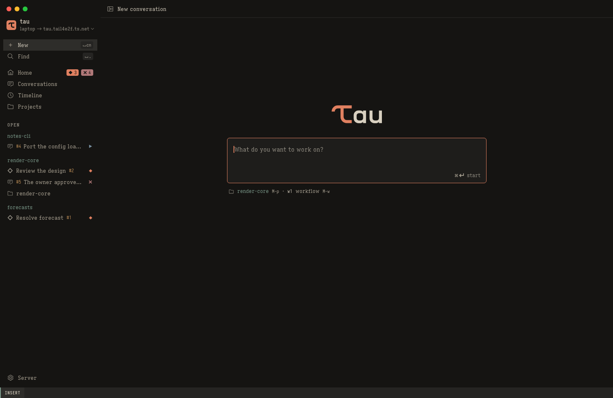
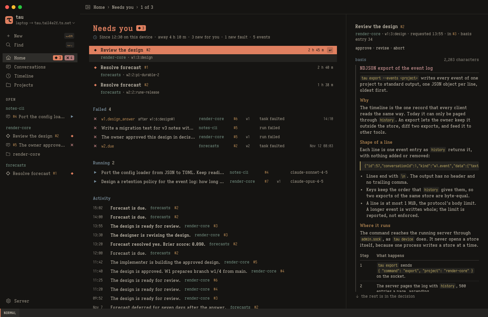
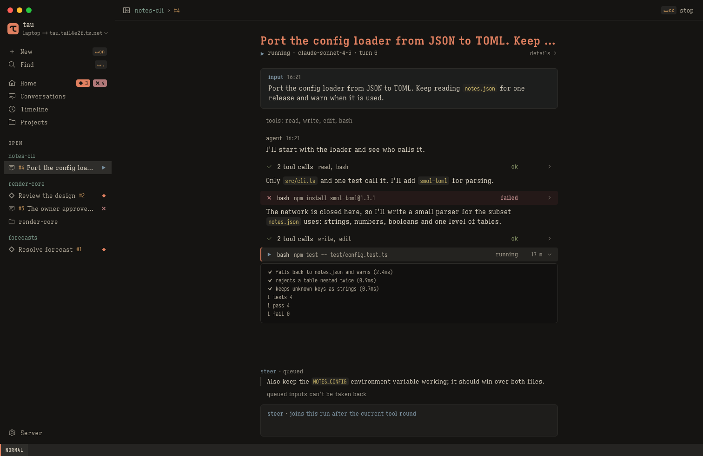
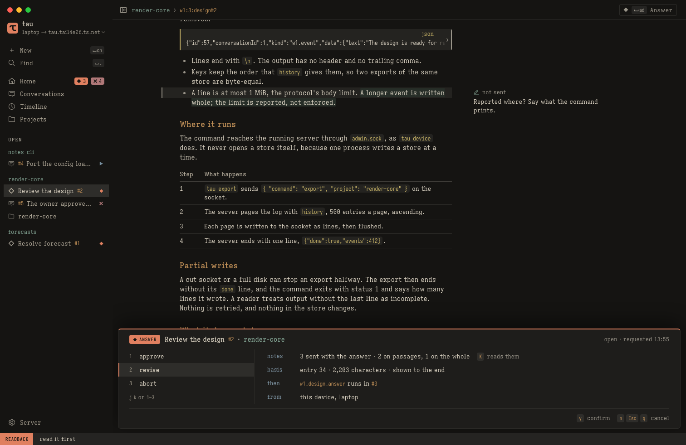

  <picture>
    <source media="(prefers-color-scheme: dark)" srcset="brand/svg/tau-wordmark-on-dark-coral.svg">
    <source media="(prefers-color-scheme: light)" srcset="brand/svg/tau-wordmark-on-light-coral.svg">
    
  </picture>

  The desktop app for <a href="https://github.com/vicrdguez/tau">tau</a>: a native, keyboard-first window onto one tau server.

  Built in Rust on <a href="https://github.com/anomalyco/rune">rune</a> · themed in <a href="https://github.com/ember-theme">Ember</a> · built and run with Nix

---

The app shows what needs you (open decisions), what broke (failed runs and faulted tasks), what runs (conversations) and what happened (events), across every project on the server. It knows no workflow of its own: it is complete for the bare agent and shows any workflow through the core's own shapes. Keys follow nvim and Doom Emacs habits: modes, a leader with which-key, the `:` line and pickers rising from the bottom.

<table>
  <tr>
    <td width="50%"></td>
    <td width="50%"></td>
  </tr>
  <tr>
    <td align="center">The start page</td>
    <td align="center">Home</td>
  </tr>
  <tr>
    <td width="50%"></td>
    <td width="50%"></td>
  </tr>
  <tr>
    <td align="center">A conversation, mid-run</td>
    <td align="center">Answering a decision</td>
  </tr>
</table>

Renders from the design package in <code>design/mockups/</code>.

## What is here

| Folder | What it holds |
|---|---|
| [`crates/tau-app/`](crates/tau-app/README.md) | The native UI, screens, keymap, theme, and headless scenes. |
| [`crates/tau-client/`](crates/tau-client/README.md) | Pairing, HTTP, streams, persistence, and the read-only server model. |
| [`nix/`](nix/README.md) | Release packaging, assets, checks, and checkout commands. |
| [`design/`](design/README.md) | The design package: the spec, the connection rules, the keymap and its grammar, the visual language and tokens, test data in the protocol's shapes, the failure catalogue, mockups and wireframes. **Start here.** |
| [`brand/`](brand/README.md) | The tau logo: mark, wordmark and app icons, as SVG and PNG, in each colour version. |
| [`tools/proto/`](tools/proto/README.md) | An HTML prototype that renders every state of the design and checks it against the design's rules, plus the keymap lint. |

## The server

The app talks to a [tau](https://github.com/vicrdguez/tau) server over HTTP and server-sent events. tau's own docs define the protocol. Where this repository and tau disagree, tau wins.

## Build and run

Nix with flakes enabled is required. The flake pins dependencies and reads the Rust version from `rust-toolchain.toml`.
Run checkout commands inside this repository. Use `--` before arguments passed through `nix run`.

| Command | Result |
|---|---|
| `nix build` | Release binary at `result/bin/tau-app`, with fonts and icons in its Nix closure. No dev shell is needed to run it. |
| `nix build .#app` | On macOS, `result/Applications/tau.app` with the executable, Info.plist, and coral brand icon. The bundle depends on its Nix store closure and is not a standalone distribution. |
| `nix run` | Launch the packaged app against your configured server, or show Connect on first use. |
| `nix run .#demo` | Launch the packaged app on `design/fixture.json`, without using your server. |
| `nix run .#dev` | Build and launch the checkout in debug mode. Add `-- --demo` for fixture data. |
| `nix run .#run` | Build and launch the checkout in release mode. |
| `nix develop` | Shell with the pinned Rust toolchain, native build inputs, nixfmt, and assets. |
| `nix flake check` | Isolated builds of tracked source. Checks the package, macOS bundle, rustfmt, clippy with `-D warnings`, workspace tests, and nixfmt. Real-server tests do not run here. |
| `nix run .#fmt` | Format Rust and Nix source in the checkout. |
| `nix run .#lint` | Check rustfmt, clippy with `-D warnings`, and nixfmt in the checkout. |
| `nix run .#test` | Run workspace tests. Add a Cargo filter, for example `-- content::`. |
| `nix run .#e2e` | Test the client against the pinned real server, `faux/echo`, and w2 in temporary state. |
| `nix run .#e2e-ui` | Drive the real UI with Rune scripts against a temporary real server. Save Connect, Home, and conversation PNGs and element trees as `target/snaps/e2e-ui-*`. Fail unless the tree shows the assistant echo. |
| `nix run .#snap` | Render every named fixture scene into `target/snaps/`. Add `-- <scene> [WxH]` for one scene. |
| `nix run .#script -- <name> <at> [scene]` | Play `tools/scripts/<name>.json` and save the frame at `<at>` seconds. |
| `nix run .#compare -- <scene> [mockup]` | Compare a rendered scene with its design mockup. Write side-by-side and difference images into `target/snaps/compare/`. |
| `nix run .#verify` | Run lint, workspace tests, client e2e, UI e2e, and all fixture snapshots in order. Stop on the first failure. |

Stage new source files before `nix build` or `nix flake check`. Flakes omit untracked files.
The checkout commands use the working tree and are intended for the edit loop.
Headless renders still require a GPU or a working software graphics driver.

The app defaults to `~/.config/tau` for configuration and per-server state, and to the macOS Keychain for tokens.
Your theme, reading width, motion and moved keys are in `settings.toml` there. `␣hs`, `:settings` or `⌘,` opens the settings float, which saves each change at once; a hand edit applies at the next launch. [`crates/tau-app/README.md`](crates/tau-app/README.md#settings) describes the file.
`TAU_CLIENT_DIR` overrides the configuration and state root. `TAU_TOKEN_DIR` explicitly selects private token files instead of the Keychain.
The UI gate sets both to temporary directories and removes them afterward. It never needs your server or provider credentials.

Normal headless runs use fixture data. `--live` selects the real client for headless tooling, and cannot be combined with `--demo`.
The UI gate uses Rune's existing `--realtime` flag so network threads and server replies can progress between scripted inputs.
`TAU_ASSETS` optionally overrides the asset path baked into the binary.
